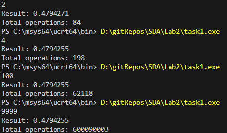
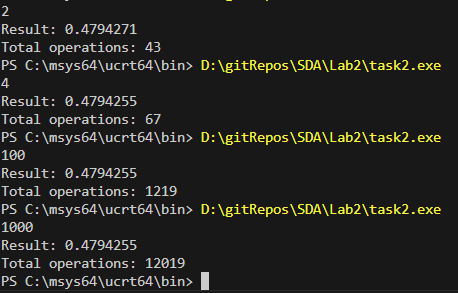
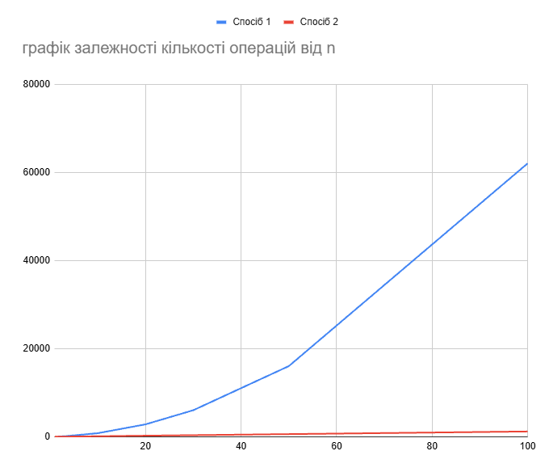
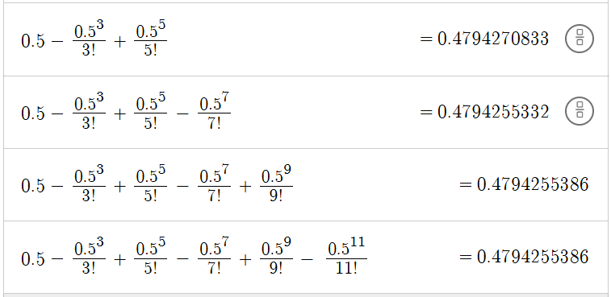
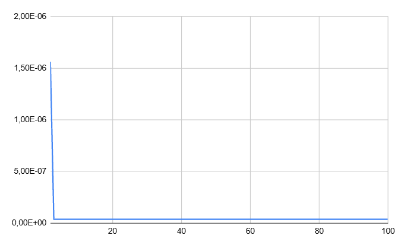

##### Міністерство освіти і науки України
##### Національний технічний університет України
##### «Київський політехнічний інститут імені Ігоря Сікорського»
##### Факультет інформатики та обчислювальної техніки
##### Кафедра обчислювальної техніки
---
# Лабораторна робота №2
## з дисципліни «Структури даних і алгоритми»

---
##### Виконав
Студент групи: ІО-61\
Аверченко Микола Миколайович\
номер у списку групи: 1

##### Перевірив
Русінов Володимир Володимирович

###### Київ 2026

---
## 1. Завдання

1. Задане натуральне число n. Обчислити значення заданої за варіантом формули (ряду або добутку, що наближено обчислює значення певної функції у заданій точці; точність наближення залежить від кількості ітерацій n).
2. Для розв'язання задачі написати **дві програми**:
   3. перша програма обчислює формулу за допомогою **вкладених циклів**;
   4. друга програма обчислює ту саму формулу за допомогою **одного циклу** з використанням **методу динамічного програмування** (тобто накопичуючи черговий доданок/множник на основі попереднього, без повторного обчислення статечних, факторіальних і подібних виразів «з нуля» на кожній ітерації).
5. Виконати розрахунок кількості операцій для кожного з алгоритмів за методикою, викладеною на лекції, додавши до неї підрахунок кількості викликів стандартних функцій.
6. Програма має правильно розв'язувати задачу при будь-якому заданому n, для якого результат обчислення коректно представляється типом `double`.
7. Результат виводити у форматі із **сімома знаками після коми**.
###### Умова до варіанту 1:
S = sin x = Σ(i=0..n) \[(−1)^i · x^(2i+1)] / (2i+1)! (x = 0.5)

---
## 2. Програмний код програм

#### 1 Програма
```c
#include <stdio.h>

int main()
{
    int n, sign = 1, op_counter = 0;
    double S = 0, P;
    op_counter += 2; // sign = 1, S = 0

    scanf("%d", &n);

    op_counter++; // i = 0
    for (int i = 0; i <= n; i++) {
        P = 1;
        op_counter += 2; // i <= n, P = 1

        op_counter++; // j = 1
        for (int j = 1; j <= 2 * i + 1; j++) {
            op_counter += 3; // j <= 2 * i + 1
            P *= 0.5 / j;
            op_counter += 3; // P = P * 0.5 / j
        }

        S += sign * P;
        op_counter += 3; // S = S + sign * P
        sign = -sign;
        op_counter += 3; // sign = -sign, i++
    }

    printf("Result: %.7f\n", S);
    printf("Total operations: %d\n", op_counter);


    return 0;
}
```
#### 2 Програма
```c
#include <stdio.h>

int main()
{
    int n, j = 2, sign = 1, op_counter = 0;;
    double x = 0.5, x_multiplier = x * x, S = 0, P = x;
    op_counter += 6; //  j = 2, sign = 1, x = 0.5, x_multiplier = x * x, P = x

    scanf("%d", &n);

    op_counter++; // i = 0
    for (int i = 0; i <= n; i++) {
        op_counter++; // i <= n
        S += sign * P;
        op_counter += 3; // S = S + sign * P
        P *= x_multiplier /  (j * (j + 1));
        op_counter += 5; // P = P * x_multiplier / (j * (j + 1))
        sign = -sign;
        j += 2;
        op_counter += 3; // sign = -sign, j = j + 2
    }

    printf("Result: %.7f\n", S);
    printf("Total operations: %d\n", op_counter);

    return 0;
}
```
---
## 3. Результати тестування
#### 1 Програма



#### 2 Програма



---
## 4. Таблиця результатів
| n                                                      | 1   | 2   | 3   | 10  | 20   | 30   | 50    | 100   |
| ------------------------------------------------------ | --- | --- | --- | --- | ---- | ---- | ----- | ----- |
| Кількість операцій, спосіб 1 (вкладені цикли)          | 45  | 84  | 135 | 828 | 2838 | 6048 | 16068 | 62118 |
| Кількість операцій, спосіб 2 (динамічне програмування) | 31  | 43  | 55  | 129 | 259  | 379  | 619   | 1219  |
#### Графік за таблицею (залежність кількості операцій від n)


---
## 5. Перевірка правильності обчислень



#### Графік абсолютної похибки для обох способів відносно значень sin x
Графік похибки збігається для обох способів обчислення

## Висновки
У результаті лабораторної роботи було створено дві програми для розрахунку наближених значень функції sin x. Перша програма була виконана з використанням вкладених циклів. У свою чергу код другої програми був написаний з використанням методів динамічного програмування, що у свою чергу підвищило ефективність алгоритму.

Перша програма, хоча й надає необхідний результат, робить це досить неефективно. Це спричинено тим, що під час виконання програма виконує надлишкові обчислення, а саме під час розрахунку частки кореня у степені і та факторіала від виразу (2і + 1) у кожній ітерації зовнішнього циклу з самого початку, для чого й знадобився вкладений цикл. Як наслідок кількість операцій зі збільшенням n зростає квадратично.

Друга програма уникає надлишкових обчислень завдяки методу динамічного програмування: програма накопичувала результати минулих ітерацій, і внаслідок визначеної кількості додаткових арифметичних операцій отримувала необхідний доданок виходячи зі значень минулого. Таким чином вдалося досягти лінійного приросту кількості операцій зі збільшенням n.

Варто зауважити, що похибка результатів обчислень зі справжнім значенням sin 0.5 в залежності від n на початку стрімко спадає, але після n = 3 залишається сталою величиною порядку -8. Така похибка спричинена точністю виводу програми, яка становить 7 знаків після коми. Незважаючи на це, похибка залишається досить малою.
Отже, застосування методу динамічного програмування дозволяє помітно знизити кількість обчислень та уникнути повторних надлишкових розрахунків.
