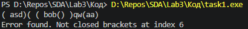
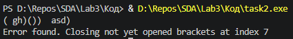
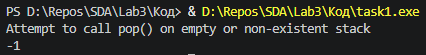
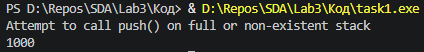

##### Міністерство освіти і науки України
##### Національний технічний університет України
##### «Київський політехнічний інститут імені Ігоря Сікорського»
##### Факультет інформатики та обчислювальної техніки
##### Кафедра обчислювальної техніки
---
# Лабораторна робота №3
## з дисципліни «Структури даних і алгоритми»

---
##### Виконав
Студент групи: ІО-61
Аверченко Микола Миколайович
номер у списку групи: 1

##### Перевірив
Русінов Володимир Володимирович

###### Київ 2026

---
## Завдання

1. Кожен варіант завдання визначає прикладну задачу (наприклад, перевірку збалансованості дужок, обчислення постфіксного виразу тощо) та структуру(и) даних, потрібну для її розв'язання (стек, чергу, або обидві).
2. Для розв'язання задачі написати **дві програми**, що реалізують ту саму структуру даних двома способами:
   а. на основі **одновимірного масиву фіксованого розміру** (з окремими змінними/індексами для вершини стека або голови й хвоста черги);
   б. на основі **однозв'язного списку** (динамічне виділення пам'яті: вузол зі значенням і вказівником на наступний вузол).

   Прикладна логіка (сама задача варіанта) в обох програмах має бути однаковою — відрізнятися має лише внутрішня реалізація стека/черги.
4. Обидві реалізації мають надавати єдиний узгоджений набір функцій, наприклад для стека: `push`, `pop`, `peek`, `is_empty`, `is_full`; для черги: `enqueue`, `dequeue`, `peek_front`, `is_empty`, `is_full`. Прикладна логіка (`main` і функції задачі) має викликати ці функції однаково незалежно від того, яка реалізація підключена — тобто дві програми відрізняються лише файлом/блоком, де реалізовані самі функції структури даних.
5. Розмір масиву для масивної реалізації взяти самостійно, достатнім для тестових прикладів (наприклад, 50–100 елементів), і оформити як іменовану константу.
6. **Масивна реалізація черги обов'язково має бути кільцевою (циклічною):** після заповнення останньої комірки масиву черга повинна продовжувати використовувати комірки, звільнені операціями `dequeue`, починаючи знову з початку масиву, а не вважати масив вичерпаним.

###### Умови до варіанту 1:
Стеком перевірити правильність вкладення дужок одного виду `()` у рядку; якщо рядок некоректний — вивести позицію першої помилки.

---
## Програмний код програм
#### Перший розв'язок (task1.c)

```c
#include <stdlib.h>
#include <stdio.h>

#define ST_SIZE 100

typedef struct {
  int *data;
  int stack_pointer; // шоб не забути: вказує на ПЕРШУ ПУСТУ КОМІРКУ [0, довжина стека]
  size_t stack_size;
} stack;

stack * stack_init(stack * st, const size_t st_size) {
  if (st && st_size) {
    st->data = malloc(st_size * sizeof(int));
    st->stack_pointer = 0;
    st->stack_size = st_size;

    if (!st->data) {
      *st = (stack){0};
      printf("Malloc failed to allocate enough memory for stack array\n");
    }

  } else {
    printf("Incorrect input for stack_init()\n");
  }

  return st;
}

char is_full(stack * st) {
  char result = -1;

  if (st && st->data) {
    result = st->stack_pointer >= st->stack_size;
  } else {
    printf("Attempt to call is_full() on non-existent stack\n");
  }

  return result;
}

char is_empty(stack * st) {
  char result = -1;

  if (st && st->data) {
    result = st->stack_pointer <= 0;
  } else {
    printf("Attempt to call is_empty() on non-existent stack\n");
  }

  return result;
}

void push(stack * st, int value) {
  if (st && st->data && !is_full(st)) {
    st->data[st->stack_pointer++] = value;
  } else {
    printf("Attempt to call push() on full or non-existent stack\n");
  }
}

int pop(stack * st) {
  int result = -1;

  if (st && st->data && !is_empty(st)) {
    result = st->data[--st->stack_pointer];
  } else {
    printf("Attempt to call pop() on empty or non-existent stack\n");
  }

  return result;
}

int peek(stack * st) {
  int result = -1;

  if (st && st->data && !is_empty(st)) {
    result = st->data[st->stack_pointer - 1];
  } else {
    printf("Attempt to call peek() on empty or non-existent stack\n");
  }

  return result;
}

void destroy(stack * st) {
  if (st && st->data) {
    free(st->data);
    *st = (stack){0};
  } else {
    printf("Attempt to call destroy() on empty or non-existent stack\n");
  }
}

int main()
{
  stack st;
  char str[ST_SIZE], error_found = 0;
  int i = 0;

  stack_init(&st, ST_SIZE);

  if (st.data != NULL) {
    // ! Для першого тесту:
    if (fgets(str, sizeof(str), stdin) != NULL) {
      while ((str[i] != '\0') && (error_found != 1)) {
        if (str[i] == '(') {
          push(&st, i);
        } else if (str[i] == ')') {
          if (is_empty(&st)) {
            error_found = 1;
            printf("Error found. Closing not yet opened brackets at index %d\n", i);
          } else {
            pop(&st);
          }
        }
        i++;
      }

      if (!is_empty(&st)) {
        do {
          i = pop(&st);
        } while (!is_empty(&st));
        printf("Error found. Not closed brackets at index %d\n", i);
      } else if (!error_found) {
        printf("Errors not found, alr boy\n");
      }
    } else {
      printf("Error during entering the input encountered\n");
    }
    // Кінець першого тесту

    // ! Для другого тесту:
    // printf("%d", pop(&st));
    // Кінець другого тесту

    // ! Для третього тесту:
    // push(&st, 23);
    // push(&st, 1);
    // push(&st, 6);
    // push(&st, 2);
    // push(&st, 1000);
    // push(&st, 23);
    // printf("%d", peek(&st));
    // Кінець третього тесту

    destroy(&st);
  } else {
      printf("Stack wasn't properly initialized\n");
  }

  return 0;
}
```

#### Другий розв'язок (task2.c)
```c
#include <stdio.h>
#include <stdlib.h>

#define BUF_SIZE 100

typedef struct linked_list {
  struct linked_list * next_ptr;
  int data;
} l_list;

typedef struct {
  l_list * list;
} stack;

stack * stack_init(stack * st) {
  if (st) {
    st->list = malloc(sizeof(l_list));

    if (!st->list) {
      *st = (stack){0};
      printf("Malloc failed to allocate enough memory for linked list\n");
    } else {
      st->list->next_ptr = NULL;
      st->list->data = -1;
    }
  } else {
    printf("Incorrect input for stack_init()\n");
  }

  return st;
}

char is_empty(stack * st) {
  char result = -1;

  if (st && st->list) {
    result = st->list->next_ptr == NULL;
  } else {
    printf("Attempt to call is_empty() on non-existent or not initialized stack\n");
  }

  return result;
}

void push(stack * st, int value) {
  if (st && st->list) {
    l_list * new_item = malloc(sizeof(l_list));
    if (new_item) {
      new_item->data = -1;
      st->list->data = value;
      new_item->next_ptr = st->list;
      st->list = new_item;
    } else {
      printf("Malloc failed to allocate enough memory for a new list item\n");
    }
  } else {
    printf("Attempt to call push() on non-existent or not initialized stack\n");
  }
}

int pop(stack * st) {
  int result = -1;

  if (st && st->list && !is_empty(st)) {
    l_list * ptr_to_del = st->list->next_ptr;
    l_list * n_ptr = ptr_to_del->next_ptr;
    result = ptr_to_del->data;
    free(ptr_to_del);
    if (n_ptr) {
      st->list->next_ptr = n_ptr;
    } else {
      st->list->next_ptr = NULL;
    }
  } else {
    printf("Attempt to call pop() on empty or non-existent or not initialized stack\n");
  }

  return result;
}

int peek(stack * st) {
  int result = -1;

  if (st && st->list && !is_empty(st)) {
    result = st->list->next_ptr->data;
  } else {
    printf("Attempt to call peek() on empty or non-existent or not initialized stack\n");
  }

  return result;
}

void destroy(stack * st) {
  if (st && st->list) {
    while (st->list->next_ptr != NULL) {
      pop(st);
    }
    free(st->list);
    *st = (stack){0};
  } else {
    printf("Attempt to call destroy() on empty or non-existent or not initialized stack\n");
  }
}

int main()
{
  stack st;
  char str[BUF_SIZE], error_found = 0;
  int i = 0;

  stack_init(&st);

  if (st.list != NULL) {
    // ! Для першого тесту:
    if (fgets(str, sizeof(str), stdin) != NULL) {
      while ((str[i] != '\0') && (error_found != 1)) {
        if (str[i] == '(') {
          push(&st, i);
        } else if (str[i] == ')') {
          if (is_empty(&st)) {
            error_found = 1;
            printf("Error found. Closing not yet opened brackets at index %d\n", i);
          } else {
            pop(&st);
          }
        }
        i++;
      }

      if (!is_empty(&st)) {
        do {
          i = pop(&st);
        } while (!is_empty(&st));
        printf("Error found. Not closed brackets at index %d\n", i);
      } else if (!error_found) {
        printf("Errors not found, alr boy\n");
      }
    } else {
      printf("Error during entering the input encountered\n");
    }
    // Кінець першого тесту

    // ! Для другого тесту:
    // printf("%d", pop(&st));
    // Кінець другого тесту

    destroy(&st);
  } else {
      printf("Stack wasn't properly initialized\n");
  }

  return 0;
}
```

---
## Тести кожної програми
\*Увесь код для кожного з тестів додав у програми у вигляді коментарів. Перший тест одразу розкоментований.

### Тест 1): звичайний випадок роботи на нетривіальному прикладі
Перша програма:


Друга програма:


### Тест 2): спроба виконати операцію на **порожній** структурі
\*Для позначення неправильного виконання функцій, які повертають значення, зробив так, щоб вони повертали -1 (значення, яке при звичайному виконанні програми ніколи не з'явиться, бо стек у програмі зберігає індекси, а вони починаються з 0). Також було змінено константу ST_SIZE до 5, щоб досягнути обмеження після 6 викликів push(). 

Перша програма:


Друга програма:
![[./img/4.png]]

### Тест 3): для масивної реалізації - спроба додати елемент у заповнену структуру



---
## Висновок
У результаті лабороторної роботи було власноруч реалізовано структуру даних стек двома способами: за допомогою масиву та однозв'язного списку. Також стек було практично застосовано для перевірки вкладення дужок.

Реалізації мають практичну різницю. Функції стеку, в якому за основу використовується масив мають таку складність: 
is_full() - O(1) (порівняння індексу вершини та розміру стека), 
is_empty() - O(1) (порівняння індексу вершини з числом),
push() - O(1) (задання значення за відомим індексом),
pop() - O(1) (отримання значення за відомим індексом та зменшення індексу),
peek() - O(1) (отримання значення за відомим індексом).
Така складність спричинена ефективністю операцій отримання, задання, видалення значення з масиву. У масиві адреса будь-якої з комірок може бути досить легко розрахована і не потребує пошуку певного елемента.
Ця перевага водночас спричиняє і головний недолік такої реалізації стека і масивів відповідно: масивам неможливо ефективно динамічно змінювати розмір. Як наслідок необхідно наперед знати, який розмір стеку потрібен. До того ж масив займає суцільний блок пам'яті, що спричиняє проблеми, якщо пам'ять є досить фрагментованою.

У свою чергу функції стеку, в якому за основу використовується однозв'язний список насправді мають таку ж саму складність, як і в стеці з масивом, а саме - O(1).
Справа в тому, що стек можливо реалізувати, навіть не звертаючись до жодного з елементів, крім першого, а отже уникнути недоліку однозв'язного списку - доступу до значення не на початку списку за O(n) операцій. До того ж така реалізація дозволяє динамічно змінювати розмір стека і не виділяти пам'ять наперед, на відміну від стека з масивом. Однак недоліком є більший обсяг пам'яті, який буде займати однозв'язний список в порівнянні з масивом з однаковою кількістю елементів, так як елемент однозв'язного списку зберігає і посилання на наступний елемент, і значення елемента.

Отже, у ході лабораторної роботи були здобуті знання з таких структур даних як стек та черга. Досвід було закріплено за допомогою власної реалізації однієї з цих структур і втілення її практичного використання. 